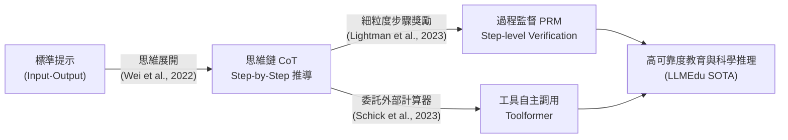

# 大模型推理能力突破路徑綜述：思維鏈、過程監督與工具調用 (Reasoning Enhancement Pathway)

本綜述梳理大語言模型（LLMs）如何逐步克服在嚴謹數理、符號邏輯與長程推理任務中「多步推理斷崖（The 20-Step Cliff）」的演進脈絡。

---

## 1. 推理能力演進三部曲 (The Evolution Trilogy)

### 階段一：啟發式分解 —— 思維鏈 (Chain-of-Thought)
* **核心代表作**：[[papers/2022-wei-chain-of-thought]]
* **機制原理**：透過 Few-shot 範例引導模型在給出解答前，顯式生成中間步驟 $S = (s_1, \dots, s_k)$。
* **突破點**：使大模型在不更動權重的情況下，於 GSM8K 等數學應用題展現湧現級解題能力。
* **殘留瓶頸**：模型屬於貪婪單向前向生成，步驟一旦出錯產生連鎖幻覺（Cascading Hallucination），且計算能力仍受限於神經網絡本身對大數相乘的統計缺陷。

### 階段二：精細化核驗 —— 過程監督 (Process Supervision)
* **核心代表作**：[[papers/2023-lightman-lets-verify-step-by-step]]
* **機制原理**：放棄僅對最終答案打分的結果監督（ORM），轉為對推導過程中的每一個 Step 給予正負獎勵信號（PRM800K）。
* **突破點**：徹底根除「歪打正著（Right for the wrong reasons）」現象，在高中奧林匹克等級的 MATH 測試集上推升至 78.2% 正確率。
* **對教育的價值**：為 [[methods/intelligent-tutoring-system]] 提供了細粒度定位學生思考盲點的診斷依據。

### 階段三：外部確定性委託 —— 工具自主調用 (Toolformer)
* **核心代表作**：[[papers/2023-schick-toolformer]]
* **機制原理**：透過自監督之損失差值過濾，模型自發學會何時插入 API 調用（如 Calculator, Wikipedia）。
* **突破點**：僅 6.7B 的輕量級模型即可在數理計算上徹底擊潰 175B 的純神經網絡模型，將「統計預測」與「符號確定性計算」進行完美解耦。

---

## 2. 橫向對比矩陣 (Comparative Matrix)

| 技術途徑 | 代表文獻 | 介入時機 | 標註/訓練開銷 | 核心優勢 | 殘留瓶頸 |
| :--- | :--- | :--- | :--- | :--- | :--- |
| **[[methods/chain-of-thought\|思維鏈 (CoT)]]** | [[papers/2022-wei-chain-of-thought]] | 推論期 (Inference-time Prompting) | 零訓練開銷，僅需少數 Exemplars | 易於實作、通用性極高、推導過程透明 | 容錯力差，多步推導易發生骨牌式崩潰 |
| **[[methods/process-supervision\|過程監督 (PRM)]]** | [[papers/2023-lightman-lets-verify-step-by-step]] | 訓練期與推論期搜尋 (Best-of-N / MCTS) | 極高（需專家逐步標註數十萬步驟） | 精準截斷邏輯謬誤、大幅強化長程複雜推理 | 標註成本難以推廣至所有長尾垂直學科 |
| **[[methods/toolformer\|工具調用 (Toolformer)]]** | [[papers/2023-schick-toolformer]] | 訓練期自監督微調 (Loss-based Filtering) | 極低（全自動自監督生成與過濾數據） | 計算絕對精確、具備即時事實檢索能力 | 無法自主串接長工具鏈（No Tool Chaining） |

---

## 3. 對智慧教育（LLMEdu）的綜合啟示
在綜合評述文獻 [[papers/2024-xu-llm-for-education-survey]] 中指出：
教育場景對準確度具備零容忍特性，且學生的思維路徑往往高度多樣。單靠純文字自回歸大模型無法達成可靠的數理導師功能。未來的教育專用模型標準架構必然是：
$$\text{Reliable ITS} = \text{CoT (啟發式思維展開)} + \text{PRM (步驟級邏輯診斷)} + \text{Tool-Use (確定性計算器/符號引擎)}$$
